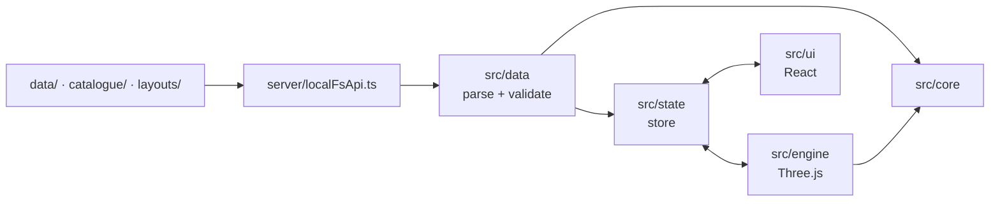

# Apartment planner

A small, local 3D interior planning tool for one specific apartment (Wohnung 33, 3.5 Zimmer).
The apartment is fixed data. Furniture and layouts are data files too, so new pieces can be added without touching
the code: see [CATALOGUE.md](CATALOGUE.md).

It runs only on this laptop: there is no hosting, no backend service, no account and no network access at runtime.

## Start

You need [Node.js](https://nodejs.org) 22.12 or newer.

```powershell
npm install   # once
npm start     # opens http://127.0.0.1:5180 in the browser
```

## Status

| Phase | Scope | State |
|---|---|---|
| 1 | Apartment geometry from the floor plan, 2D + 3D views, plan underlay, verification | **done**, waiting for tape measurements |
| 2 | Furniture catalogue (parametric + GLB), drag and drop, move/rotate/delete, materials | **done** |
| 3 | Snapping, collisions, measurements, stacking, wall items, undo/redo | **done** |
| 4 | Layouts (save, switch, duplicate, compare), wall colours and floors, first-person walk, daylight, doors | **done** |
| 5 | `CATALOGUE.md`, Copilot instructions, starter catalogue, demo layout | **done** |

## Using the tool

| | |
|---|---|
| **Views** | **2D**, **3D** and **Walk** in the toolbar; <kbd>Tab</kbd> switches between 2D and 3D. Each view keeps its own camera. |
| **Navigate** | 2D: drag to pan, wheel to zoom. 3D: drag to orbit, right-drag to pan, wheel to zoom. <kbd>F</kbd> or **Fit** shows the whole apartment. |
| **Walk** | First person at eye height, starting just inside the entrance. <kbd>W</kbd> <kbd>A</kbd> <kbd>S</kbd> <kbd>D</kbd> walk, the arrow keys turn and look up or down, <kbd>Shift</kbd> runs. Click into the view to look around with the mouse; <kbd>Esc</kbd> frees the mouse, a second <kbd>Esc</kbd> leaves. Walls, closed doors and fixtures stop you, furniture only with **Bump into furniture**. The bar at the bottom also sets the eye height. |
| **Furniture** | **☰ Furniture** shows or hides the catalogue on the left, with search and categories. **Placed** lists everything in the layout. |
| **Place** | Drag a card into the view. Or click a card, then click into the view: the preview follows the pointer, <kbd>R</kbd> turns it, <kbd>Esc</kbd> cancels. |
| **Move** | Click an item to select it and drag it. Arrow keys nudge it by 1 cm (with <kbd>Shift</kbd> 10 cm). <kbd>Esc</kbd> during a drag cancels it. |
| **Rotate** | Drag the blue ring around the selected item (with **15° steps** on: 15° steps; <kbd>Shift</kbd> 90°, <kbd>Alt</kbd> free). The dot on the ring marks the item's front. Keys: <kbd>R</kbd> / <kbd>Shift</kbd>+<kbd>R</kbd> ±90°, <kbd>E</kbd> / <kbd>Q</kbd> ±15°. |
| **Stack** | Drop a lamp or another `onTop` item onto a sideboard, a table or a shelf board: it stands on it and moves with it. |
| **Wall items** | Shelves, pictures and the TV hang on the nearest wall. Set their height in **Inspect**. |
| **Duplicate / delete** | <kbd>Ctrl</kbd>+<kbd>D</kbd> / <kbd>Del</kbd>, or the buttons in **Inspect**; what stands on the item comes along. **Lock** protects an item from changes, **Hide** hides it (show it again from **Placed**). |
| **Undo / redo** | <kbd>Ctrl</kbd>+<kbd>Z</kbd> / <kbd>Ctrl</kbd>+<kbd>Y</kbd>, or ↶ ↷ in the toolbar: every change to the layout, including materials, colours and doors. Each layout has its own history while the app runs. |
| **Placement aids** | The bar at the bottom of the view (at the bottom of the page on narrow screens): **Wall snap** (back flush to a wall, into corners), **Grid** and its size, **15° steps**, **Collisions** *Off* / *Warn* (red overlaps, amber warnings) / *Block* (items stop at walls, fixtures and other items), **Distances** to the nearest wall, fixture or item while moving, and **Clearance** zones. Every setting is remembered. |
| **Tape measure** | **📏 Measure** or <kbd>M</kbd>, then click two points, in 2D or 3D. It snaps to corners, edges and midpoints; <kbd>Shift</kbd> keeps the line straight, <kbd>Alt</kbd> turns snapping off. The lines stay until **Clear**. |
| **Materials** | **Inspect** shows the selected item's material slots (e.g. upholstery, legs) with the colours and materials its catalogue entry allows. Click a swatch. |
| **Position** | **Inspect** also takes exact values: x, z, rotation, and the height of wall items. Sizes come from the catalogue only. |
| **Doors** | Click a door. Its slider in **Inspect** shows it closed, ajar or open: the interior doors up to 180°, unless a wall stops them first; the balcony doors and the entrance door up to 90°. Only how the door is shown, saved with the layout. Furniture in a door's swing gets a warning. |
| **Colours and floors** | Click a room to choose its wall colour and floor for this layout, or a wall for the colour of that side. |
| **Daylight** | **☀ Daylight**: sunlight through the windows on a date (or today) and at a time of day, from the apartment's real orientation. |
| **Layouts** | The layout menu (▤ and the layout's name): open another layout, **New…**, **Duplicate…** (start a variant from the open one), **Rename…**, **Delete…** (moves it to `layouts/.trash/`), and **Compare**: a second layout side by side, read-only, with the cameras linked. |
| **Saving** | Every change is saved to the open layout's file in `layouts/` within a second (status top right). If the file changes on disk it is reloaded. If it is broken, editing pauses until it's fixed, so it is never overwritten. |
| **Plan underlay** | 2D only. Shows the original floor plan with adjustable opacity, to check that the derived walls, doors and windows sit on its lines. |
| **Inspect** | Click a room, wall, door, window, fixture or piece of furniture to see its data. <kbd>Esc</kbd> clears the selection. **Inspect ☰** in the toolbar shows or hides the panel (with the number of issues while it's hidden). |
| **Verify** | Room areas compared with the printed areas, the tape-measure checklist (click an item to see a magenta dimension line for exactly what to measure), and all uncertain values. |
| **Issues** | Problems found in the data, catalogue and layout files, with file, property path and a hint. |

Data, catalogue and layout files are reloaded automatically when they change on disk. A broken file shows an error
and does not crash the app. `layouts/demo.json` is an example layout that shows every kind of item.

### Keyboard

| Key | 2D and 3D | Walk |
|---|---|---|
| <kbd>Tab</kbd> | switch between 2D and 3D | back to 3D |
| <kbd>F</kbd> | show the whole apartment | back to the entrance |
| <kbd>W</kbd> <kbd>A</kbd> <kbd>S</kbd> <kbd>D</kbd> | | walk forwards, left, back, right |
| Arrow keys | nudge the selected item 1 cm (<kbd>Shift</kbd>: 10 cm) | turn left and right, look up and down |
| <kbd>Shift</kbd> | | run |
| <kbd>R</kbd> / <kbd>Shift</kbd>+<kbd>R</kbd>, <kbd>E</kbd> / <kbd>Q</kbd> | rotate ±90°, ±15° | |
| <kbd>Del</kbd>, <kbd>Ctrl</kbd>+<kbd>D</kbd> | delete, duplicate | |
| <kbd>M</kbd> | tape measure | |
| <kbd>Ctrl</kbd>+<kbd>Z</kbd>, <kbd>Ctrl</kbd>+<kbd>Y</kbd> | undo, redo | undo, redo |
| <kbd>Esc</kbd> | cancel placing, a drag or a measurement; clear the selection | free the mouse; again: leave |

## Commands

| Command | What it does |
|---|---|
| `npm start` | Start the tool and open the browser |
| `npm run validate` | Validate all data, catalogue and layout files with the same rules as the app; non-zero exit on errors |
| `npm test` | Unit tests (Vitest), including checks against the real data files and the examples in `CATALOGUE.md` |
| `npm run typecheck` | TypeScript type check |
| `npm run lint` | ESLint, including the architecture rules below |
| `npm run schemas` | Regenerate `schemas/*.schema.json` from the Zod schemas |
| `npm run checklist` | Regenerate `docs/measurement-checklist.md` from `data/apartment.json` |
| `npm run make-example-glb` | Rebuild `catalogue/example-stool-glb/model.glb`, the GLB example made from primitives |

## Folder structure

```text
CATALOGUE.md            how to add furniture (format, placement types, material slots, examples)
.github/
  copilot-instructions.md  conventions for GHCP: furniture only in catalogue/, units, coordinates, validation
data/
  apartment.json        the fixed apartment: rooms, walls, doors, windows, kitchen, built-ins (+ provenance)
  materials.json        material presets (colours, wood, fabric, metal, paint, floors, …)
  underlay/floorplan.png  cropped floor plan without the address header, for the 2D underlay
catalogue/              furniture, one item per file (or per folder with its 3D model) – see CATALOGUE.md
layouts/
  *.json                one file per layout, autosaved; tracked in git
  demo.json             an example layout
  .trash/               deleted layouts (git-ignored)
schemas/                GENERATED JSON Schemas for editor validation – don't edit
docs/
  DATA.md               data formats, units and coordinate system
  measurement-checklist.md  what to measure on site
reference/              LOCAL ONLY (gitignored): the original floor plan PDF and photos
server/localFsApi.ts    Vite plugin: the local file API (the only code that touches the disk)
src/
  core/                 pure TypeScript: schemas, validation, layout commands, placement, geometry, sun, walking
  data/                 loads the data folders through the file API, validates, reports issues, saves layouts
  state/                Zustand store (data, catalogue, layout, history, view, selection, preferences)
  engine/               Three.js: builders, furniture and 3D models, interaction, materials, views, overlays, light
  ui/                   React panels and toolbars
tools/
  validate.ts, gen-schemas.ts, gen-checklist.ts, make-example-glb.ts, docs.test.ts
  floorplan/            dev-only Python scripts that derived the apartment from the PDF
```

## Architecture



The most important property is the strict separation between the engine, the apartment data, the catalogue data
and the layout data:

- Data files are never imported by the code. They are fetched at runtime through the local file API
  (`GET /api/files?dir=…`), validated, and every problem becomes an entry in the Issues panel.
- The engine contains no room, wall or item ids. Everything it draws comes from the data. Furniture is built from
  its catalogue entry only, so adding an item never needs a code change.
- ESLint enforces the layers: nothing in `src/` may import data files (`.json`, 3D models, images), `src/core` may
  not import Three.js or React, and the engine may not import React.

**Why this stack.** Vite + TypeScript + Three.js run in the browser with one command and no packaging. React is
used only for panels. Zod schemas give runtime validation, TypeScript types and the generated JSON Schemas from
one definition. A tiny Vite plugin serves the data folders and pushes file changes. Unlike the File System Access
API it works in every browser, never asks for permission, can list folders for auto-discovery, and sees edits made
by GHCP immediately.

**Saving.** The same plugin has exactly two write endpoints, both for layouts only: `PUT /api/layouts/<name>.json`
writes a layout and `DELETE` moves one to `layouts/.trash/`. They accept only layout file names (writes at most
1 MB), reject requests from other websites (Origin check), and write atomically (a temporary file, then a rename),
so a crash can't leave a half-written layout. Each request names the version of the file it is based on and is
refused if the file was changed outside the app in the meantime, so an edit by you or GHCP is never overwritten.

## Privacy

The original floor plan and the photos contain the street address and the apartment's interior. They stay in
`reference/`, which is gitignored. Only the cropped underlay without the address header is committed.
