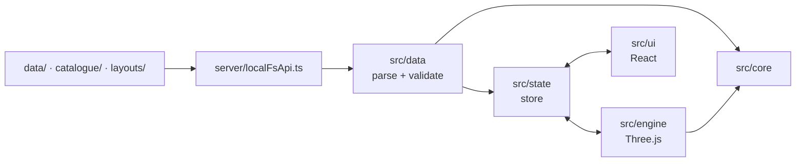

# Apartment planner

A small, local 3D interior planning tool for one specific apartment (Wohnung 33, 3.5 Zimmer).
The apartment is fixed data. Furniture and layouts will be data files too, so new pieces can be added
without touching the code.

It runs only on this laptop: there is no hosting, no backend service, no account and no network access at runtime.

## Start

You need [Node.js](https://nodejs.org) 22 or newer.

```powershell
npm install   # once
npm start     # opens http://127.0.0.1:5180 in the browser
```

## Status

| Phase | Scope | State |
|---|---|---|
| 1 | Apartment geometry from the floor plan, 2D + 3D views, plan underlay, verification | **done**, waiting for tape measurements |
| 2 | Furniture catalogue (parametric + GLB), drag and drop, move/rotate/delete, materials | next |
| 3 | Snapping, collisions, measurements, stacking, wall items, undo/redo | |
| 4 | Layouts (save/compare), wall and floor colours, first-person walk, daylight | |
| 5 | `CATALOGUE.md`, Copilot instructions, starter catalogue | |

## Using the tool

| | |
|---|---|
| **2D / 3D** | Toolbar buttons or <kbd>Tab</kbd>. 2D is a top-down plan, 3D an orbit view. Each view keeps its own camera. |
| **Navigate** | 2D: drag to pan, wheel to zoom. 3D: drag to orbit, right-drag to pan, wheel to zoom. <kbd>F</kbd> or **Fit** shows the whole apartment. |
| **Plan underlay** | 2D only. Shows the original floor plan over the model with adjustable opacity, to check that the derived walls, doors and windows sit on its lines. |
| **Inspect** | Click a room, wall, door, window or fixture to see its data and how certain each value is. <kbd>Esc</kbd> clears the selection. |
| **Verify** | Room areas compared with the printed areas, the tape-measure checklist (click an item to see a magenta dimension line for exactly what to measure), and all uncertain values. |
| **Issues** | Problems found in the data files, with file, property path and a hint. |

Data files are reloaded automatically when they change on disk. A broken file shows an error and does not crash the app.

## Commands

| Command | What it does |
|---|---|
| `npm start` | Start the tool and open the browser |
| `npm run validate` | Validate all data files with the same rules as the app; non-zero exit on errors |
| `npm test` | Unit tests (Vitest), including checks against the real data files |
| `npm run typecheck` | TypeScript type check |
| `npm run lint` | ESLint, including the architecture rules below |
| `npm run schemas` | Regenerate `schemas/*.schema.json` from the Zod schemas |
| `npm run checklist` | Regenerate `docs/measurement-checklist.md` from `data/apartment.json` |

## Folder structure

```text
data/
  apartment.json        the fixed apartment: rooms, walls, doors, windows, kitchen, built-ins (+ provenance)
  materials.json        material presets (colours, wood, fabric, metal, …)
  underlay/floorplan.png  cropped floor plan without the address header, for the 2D underlay
catalogue/              furniture, one item per file (Phase 2)
layouts/                saved layouts as readable JSON (Phase 4)
schemas/                GENERATED JSON Schemas for editor validation – don't edit
docs/
  DATA.md               data formats, units and coordinate system
  measurement-checklist.md  what to measure on site
reference/              LOCAL ONLY (gitignored): the original floor plan PDF and photos
server/localFsApi.ts    Vite plugin: the local file API (the only code that touches the disk)
src/
  core/                 pure TypeScript: schemas, validation, geometry (no Three.js, no React)
  data/                 loads the data folders through the file API, validates, reports issues
  state/                Zustand store (data snapshot, view, selection, preferences)
  engine/               Three.js: builders, materials, views, overlays, lighting
  ui/                   React panels and toolbar
tools/
  validate.ts, gen-schemas.ts, gen-checklist.ts
  floorplan/            dev-only Python scripts that derived the apartment from the PDF
```

## Architecture



The most important property is the strict separation between the engine, the apartment data, the catalogue data
and the layout data:

- Data files are never imported by the code. They are fetched at runtime through the local file API
  (`GET /api/files?dir=…`), validated, and every problem becomes an entry in the Issues panel.
- The engine contains no room, wall or item ids. Everything it draws comes from the data.
- ESLint enforces the layers: nothing in `src/` may import JSON or catalogue/layout files, `src/core` may not
  import Three.js or React, and the engine may not import React.

**Why this stack.** Vite + TypeScript + Three.js run in the browser with one command and no packaging. React is
used only for panels. Zod schemas give runtime validation, TypeScript types and the generated JSON Schemas from
one definition. A tiny Vite plugin serves the data folders and pushes file changes. Unlike the File System Access
API it works in every browser, never asks for permission, can list folders for auto-discovery, and sees edits made
by GHCP immediately.

## Privacy

The original floor plan and the photos contain the street address and the apartment's interior. They stay in
`reference/`, which is gitignored. Only the cropped underlay without the address header is committed.
